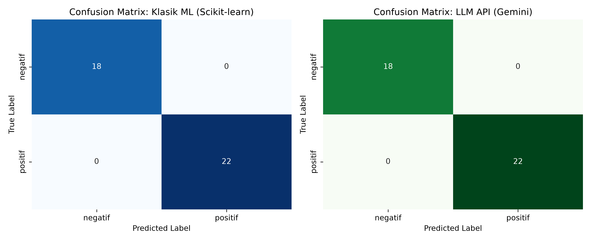

# Eksperimen & Evaluasi Model AI: Klasifikasi Sentimen Ulasan Pelanggan E-Commerce

Proyek ini berisi eksperimen komparatif antara dua pendekatan kecerdasan buatan (AI) untuk menyelesaikan kasus penggunaan *Sentiment Analysis* pada ulasan produk e-commerce:
1. **Pendekatan 1 — Model Klasik Machine Learning:** Menggunakan `TfidfVectorizer` dan `LogisticRegression` dari pustaka `scikit-learn`.
2. **Pendekatan 2 — Large Language Model (LLM) API:** Menggunakan keluarga model Gemini 3.x (`gemini-3.1-flash-lite` hingga `gemini-3.8-flash`) melalui Google GenAI SDK (`google-genai`) dengan pendekatan *Zero-Shot Prompting*, rotasi *model fallback*, dan *in-memory caching*.

---

## 1. Problem Statement & Deskripsi Dataset

### Problem Statement
* **Objective:** Membangun prototipe klasifikasi sentimen otomatis untuk mengelompokkan ulasan pelanggan pada halaman produk e-commerce ke dalam sentimen positif atau negatif, serta mengevaluasi *trade-off* performa, kecepatan, reliabilitas, dan biaya operasional antara model klasik ML dan LLM API sebagai dasar rekomendasi sistem produksi.
* **Definisi Target/Label:**
  * `positif`: Ulasan pelanggan yang menunjukkan kepuasan terhadap kualitas produk, kesesuaian deskripsi, kecepatan pengiriman, maupun pelayanan penjual.
  * `negatif`: Ulasan pelanggan yang berisi komplain terkait produk rusak/cacat, ketidaksesuaian ukuran/warna, indikasi barang palsu, atau pengiriman dan respon komplain yang lambat.
* **Batasan & Asumsi:**
  * Klasifikasi bersifat biner (`positif` vs `negatif`), tidak mencakup sentimen netral maupun *aspect-based sentiment analysis*.
  * Teks ulasan berbahasa Indonesia dengan struktur kalimat formal hingga semi-informal.
  * Evaluasi dilakukan pada *test set* yang sama persis ($n = 40$) hasil pembagian *stratified train-test split* (80% *train*, 20% *test*, `random_state=42`).

### Profil Dataset (`data/customer_reviews_sentiment.csv`)
* **Jumlah Data:** 200 baris ulasan dan 4 kolom (`review_id`, `product_name`, `review_text`, `sentiment`).
* **Distribusi Label:** 110 ulasan `positif` (55%) dan 90 ulasan `negatif` (45%).
* **Pembagian Data:** 160 sampel *training set* (88 positif, 72 negatif) dan 40 sampel *test set* (22 positif, 18 negatif).
* **Karakteristik Data:** Terdapat 40 variasi kalimat unik di dalam total 200 baris ulasan (pada *test set* $n=40$, terdapat 26 kalimat unik dan 14 pengulangan kalimat).

---

## 2. Ringkasan Eksperimen Kedua Pendekatan

### Pendekatan 1: Model Klasik (`scikit-learn`)
* **Preprocessing & Feature Extraction:** Menggunakan `TfidfVectorizer(lowercase=True, ngram_range=(1, 2))` untuk mengubah teks menjadi representasi numerik berbobot TF-IDF sekaligus menangkap konteks frasa dua kata (*bigram*) seperti `"tidak sesuai"`, `"tidak berfungsi"`, dan `"tidak mengecewakan"`.
* **Algoritma Klasifikasi:** Menggunakan `LogisticRegression(random_state=42, max_iter=1000)` yang dilatih pada 160 sampel *training set*.

### Pendekatan 2: LLM API (`Gemini API`)
* **Desain Prompt:** Menggunakan *Zero-Shot Prompting* dengan instruksi eksplisit agar model hanya mengeluarkan satu kata (`positif` atau `negatif`).
* **Konfigurasi Parameter & Resiliensi API:**
  * `CANDIDATE_MODELS = ['gemini-3.1-flash-lite', 'gemini-3.5-flash-lite', 'gemini-2.5-flash-lite', 'gemini-3.7-flash', 'gemini-3.8-flash']`: Diterapkan antrean *multi-model fallback* karena `gemini-2.0-flash` telah *deprecated* (`404 NOT_FOUND`) dan endpoint tunggal kerap mengalami `503 UNAVAILABLE` (*high demand*) atau `504 DEADLINE_EXCEEDED`.
  * `temperature = 0.0`: Dipilih agar output model bersifat deterministik (*greedy decoding*) dan konsisten.
  * `HttpOptions(timeout=20000)` tanpa batas sempit `max_output_tokens`: Mencegah *socket hang* serta mencegah pemotongan sub-token (`pos`/`neg`).
  * **In-Memory Caching (`llm_cache`) & Post-processing (`normalize_sentiment_label`):** Menyimpan hasil prediksi kalimat identik agar hemat kuota API dan menormalisasi variasi output menjadi label standar `'positif'` atau `'negatif'`.

---

## 3. Hasil Evaluasi dan Perbandingan

Kedua pendekatan diuji pada *test set* yang sama ($n = 40$: 22 `positif`, 18 `negatif`).

### Tabel Ringkasan Metrik Evaluasi

| Pendekatan | Accuracy | Precision (Weighted) | Recall (Weighted) | F1-Score (Weighted) | Waktu Training | Waktu Inferensi (40 sampel) | Biaya Operasional |
| :--- | :---: | :---: | :---: | :---: | :---: | :---: | :--- |
| **Pendekatan 1: Klasik ML (TF-IDF + LR)** | **1.0000** | **1.0000** | **1.0000** | **1.0000** | ~0.0085 detik | **~0.0012 detik** | Gratis (Lokal/CPU) |
| **Pendekatan 2: LLM API (Gemini Flash Family)** | **1.0000** | **1.0000** | **1.0000** | **1.0000** | 0 detik (Tanpa Training) | ~248.65 detik | Berbayar per Token API |

### Confusion Matrix (Kedua Pendekatan)

Baik Model Klasik maupun Gemini API menghasilkan prediksi sempurna pada ke-40 data uji:

| Aktual \ Prediksi | `negatif` | `positif` |
| :--- | :---: | :---: |
| **`negatif`** | 18 (True Negative) | 0 (False Positive) |
| **`positif`** | 0 (False Negative) | 22 (True Positive) |



---

## 4. Analisis Trade-off dan Limitation

### a. Perbandingan Performa (Metrik Evaluasi)
Dari sisi metrik evaluasi (*Accuracy, Precision, Recall, F1-Score*), kedua pendekatan mencapai skor identik **1.00 (100%)** pada *test set*. Kalimat ulasan pada dataset memiliki polaritas diksi yang sangat tegas, sehingga baik pendekatan statistik berbasis frekuensi kata (TF-IDF) maupun pendekatan pemodelan bahasa kontekstual (LLM) dapat memisahkan kedua kelas tanpa kesalahan.

### b. Analisis Trade-off (Effort, Kecepatan, Reliabilitas, dan Biaya)
1. **Effort Implementasi & Reliabilitas Produksi:**
   * Meskipun LLM API tidak memerlukan proses *training* awal, eksperimen membuktikan bahwa integrasi LLM API membutuhkan *engineering effort* signifikan untuk menangani *model deprecation* (`404`), lonjakan trafik server (`503 UNAVAILABLE`), dan *gateway timeout* (`504 DEADLINE_EXCEEDED`).
   * Sebaliknya, model klasik `scikit-learn` berjalan secara lokal dengan stabilitas 100% tanpa ketergantungan jaringan eksternal.
2. **Kecepatan Inferensi & Throughput:**
   * **Model Klasik** sangat unggul dengan waktu inferensi **~1.2 milidetik** untuk seluruh 40 ulasan sekaligus.
   * **LLM API** membutuhkan waktu **~248 detik** akibat latensi jaringan HTTP per panggilan dan penalti waktu tunggu (*retry/failover*) saat endpoint utama mengalami `503`/`504`.
3. **Biaya Operasional (Cost Scalability):**
   * **Model Klasik** memiliki biaya marginal mendekati **Rp 0** per prediksi.
   * **LLM API** mengenakan biaya proporsional terhadap volume token yang akan membengkak pada skala jutaan ulasan e-commerce.

### c. Keterbatasan (Limitations) & Observasi Kesalahan
* **Keterbatasan Dataset & Model Klasik:**
  1. **Duplikasi Kalimat pada Dataset:** Hanya terdapat 40 kalimat unik dari 200 baris total (26 kalimat unik di *test set*), sehingga kosakata di *test set* sudah tercakup di *training set*.
  2. **Masalah *Out-of-Vocabulary* (OOV) & Slang Baru:** Model klasik rentan gagal mengenali bahasa gaul baru (*slang*), *typo* ekstrem, atau sarkasme yang belum ada pada data latih.
* **Keterbatasan LLM API (Terbukti Secara Empiris):**
  1. **Gangguan Ketersediaan Server (`503` & `504`):** Selama pengujian, endpoint `gemini-3.1-flash-lite` dan `gemini-3.8-flash` beberapa kali mengalami `504 DEADLINE_EXCEEDED` dan `503 UNAVAILABLE`, sehingga memerlukan mekanisme *multi-model fallback*.
  2. **Risiko Pemotongan Token (*Sub-token Truncation*):** Pembatasan `max_output_tokens` yang terlalu sempit pada model generasi 3.x sempat memotong jawaban menjadi `'neg'` atau `'pos'`, sehingga memerlukan fungsi normalisasi regex.

---

## 5. Rekomendasi Technical Approach

> **Rekomendasi Utama: Menggunakan Model Klasik Machine Learning (`TF-IDF + Logistic Regression`) sebagai mesin inferensi utama (*Primary Production Engine*), yang diperkuat dengan LLM API (`Gemini`) secara asinkron sebagai *Fallback & Automated Data Labeling Engine* (Arsitektur Hibrida).**

### Alasan Pemilihan:
1. **Latensi Rendah & Ketersediaan Tinggi (*High Availability*):** Halaman produk e-commerce membutuhkan respons instan (< 5 ms) dan bebas dari risiko *timeout* `503`/`504` pihak ketiga.
2. **Efisiensi Biaya Skala Besar:** Menangani mayoritas trafik ulasan standar secara lokal dengan biaya nol.
3. **Mitigasi OOV/Slang dengan Confidence-Based Routing:**
   * Ulasan dengan *confidence score* `predict_proba()` tinggi ($\ge 0.80$) langsung dilayani oleh model klasik.
   * Ulasan ambigu/slang baru dengan *confidence score* rendah ($< 0.80$) dikirim ke antrean latar belakang (*background queue*) untuk dilabeli oleh **Gemini API** dan ditambahkan ke dataset untuk *re-training* berkala.

---

## 6. Cara Menjalankan Proyek

```bash
git clone https://github.com/username/assignment-model-experiment-mikha-kristofer.git
cd assignment-model-experiment-mikha-kristofer

python -m venv venv
# Aktivasi di Windows:
venv\Scripts\activate
# Aktivasi di macOS/Linux:
source venv/bin/activate

pip install -r requirements.txt
```

Buat file `.env` di direktori utama proyek:
```env
GEMINI_API_KEY=AIzaSyYourActualGeminiAPIKeyHere
```

Lalu jalankan `notebook/experiment_notebook.ipynb` melalui VS Code atau Jupyter Notebook.
